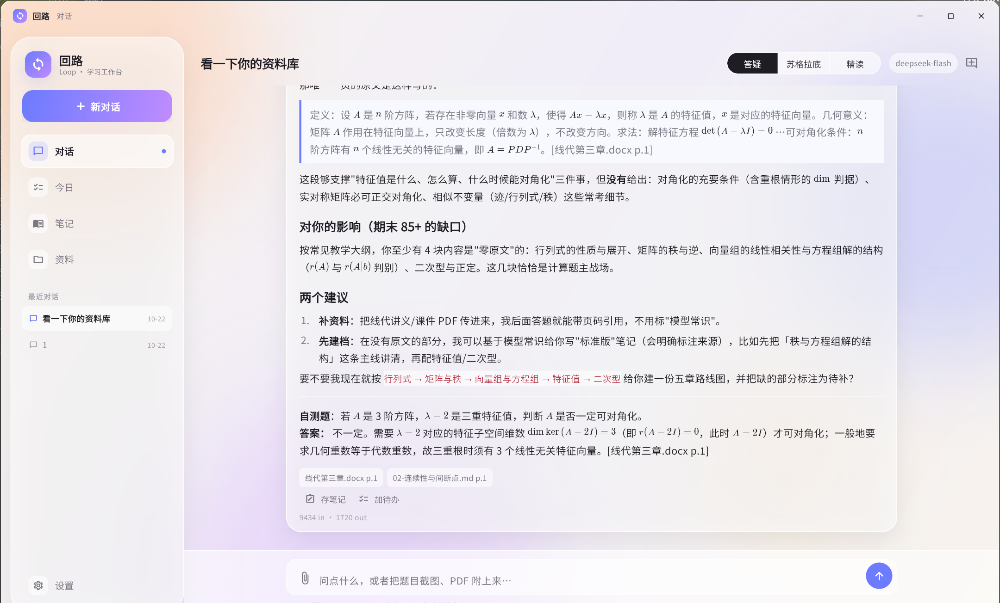
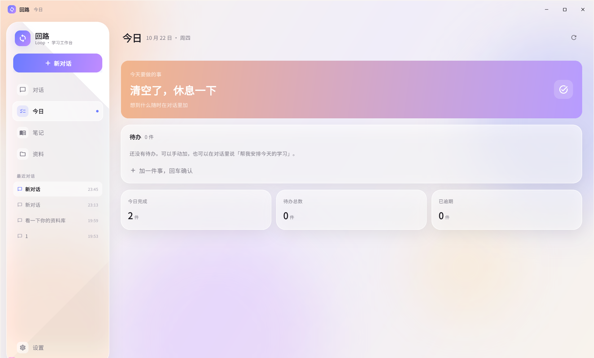
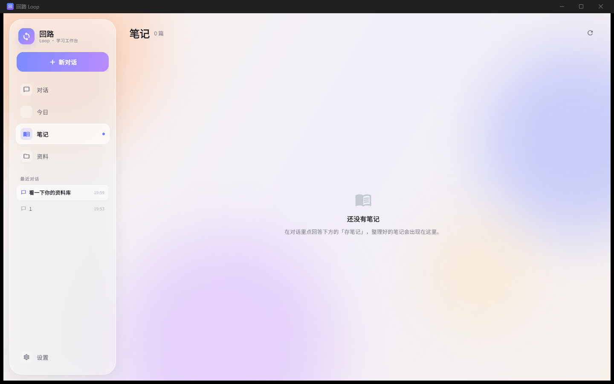
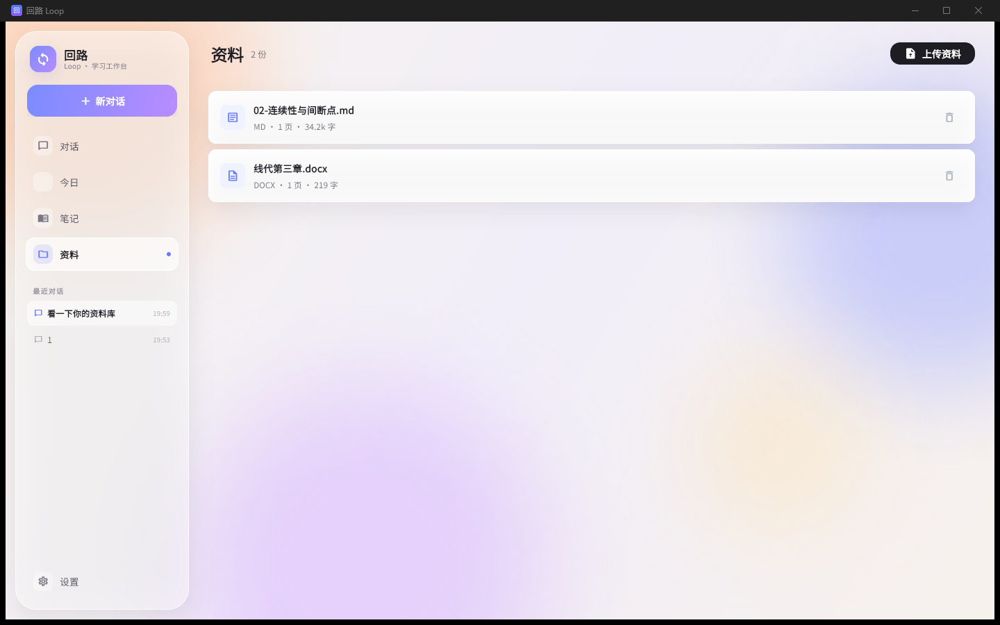
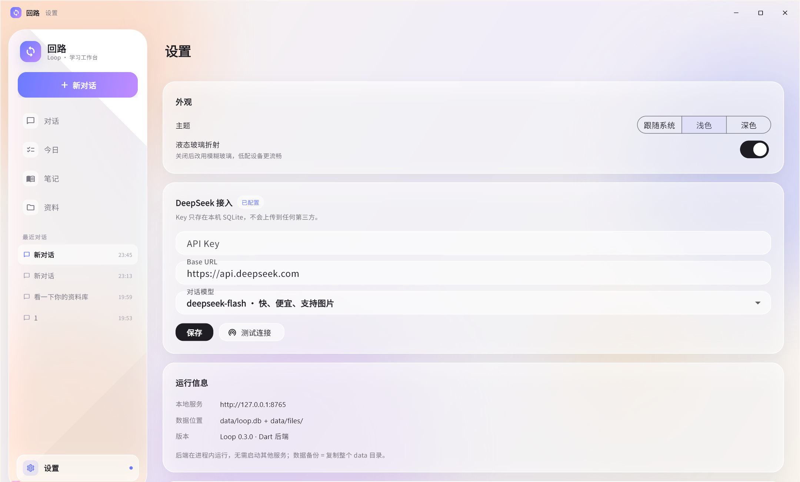
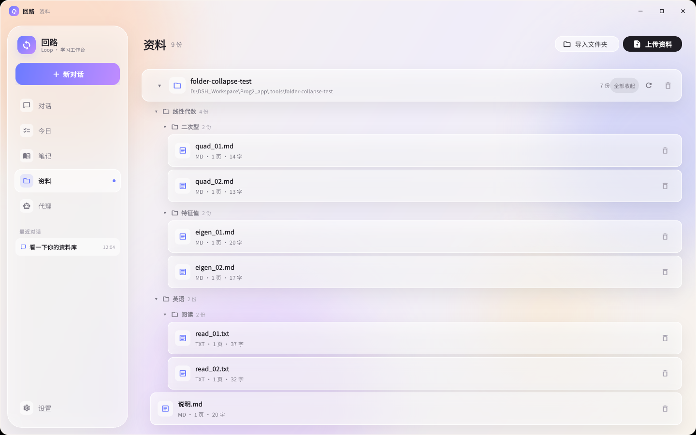
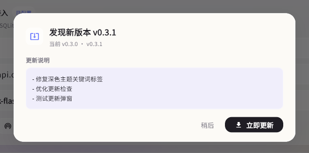
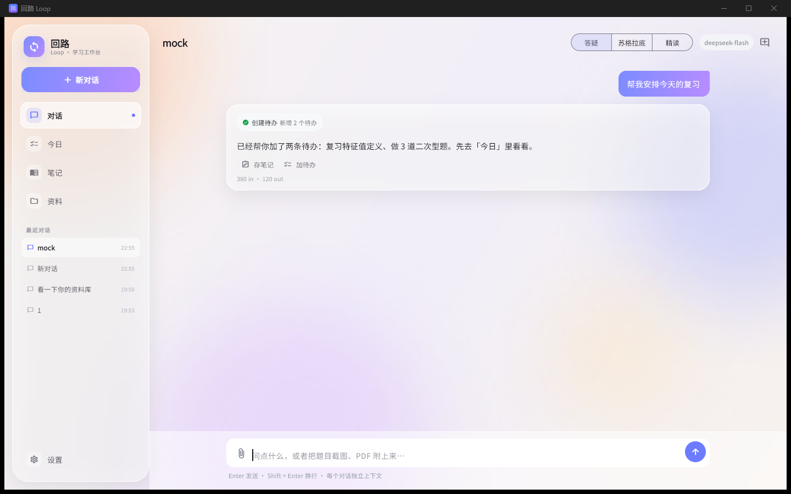

# 回路 Loop · AI 学习工作台（v0.3）

一个给自己用的 AI 学习工具：**打开就是对话**，左边是功能列表。
对话支持历史记录、图片提问、上传资料检索；「今日」是一个纯粹的 To-do。

| 对话（含历史） | 今日 To-do |
|---|---|
|  |  |

| 笔记 | 资料 |
|---|---|
|  |  |

| 设置 |
|---|
|  |

| 文件夹收起 | 全部展开 |
|---|---|
|  |  |

| 更新弹窗（深色） | 更新弹窗（浅色） |
|---|---|
|  |  |

| 深色模式 |
|---|
|  |

> 产品方案：[docs/产品方案-v0.2.md](docs/产品方案-v0.2.md)
> 技术设计：[docs/技术设计-v0.1.md](docs/技术设计-v0.1.md)
> 自动更新：[docs/自动更新.md](docs/自动更新.md)

## 30 秒跑起来

1. 双击 **`start.bat`**
2. 浏览器打开 `http://127.0.0.1:8765`
3. 左下角 **设置** → 粘贴 DeepSeek API Key → 保存 → 测试连接
4. 回对话，发一句话试试

> 首次运行会自动创建 Python 环境并安装依赖；前端已经构建好放在 `server/web`。

## 这一版改了什么（v0.2）

按反馈调整（v0.2），以及 v0.3 的后端重写：

- ✅ **对话历史**：每个对话独立存在数据库里，左侧「最近对话」可随时切回；点「新对话」会真的调接口创建一个新会话，**上下文互不影响**（服务端只带该会话最近 8 条消息）。
- ✅ **今日 = To-do**：去掉了「今天要复习」，现在只有待办、勾选、逾期标记、今日完成数。
- ✅ **取消复习 / 卡片**：复习页、FSRS、生成卡片、出题全部移除。
- ✅ **取消科目 / 统计**：不再选科目，问答面向任意内容；统计页移除。
- ✅ **全功能问答**：AI、数学、英语、任何问题，不再限定科目。
- ✅ **资料增强**：点资料可以预览解析出来的原文，方便确认抽没抽对。
- ✅ **v0.3 后端重写**：Python sidecar 全部换成 Dart，跑在 Flutter 进程内；无子进程、无黑框、启动即用。

## 已实现

| 模块 | 状态 | 说明 |
|---|---|---|
| 对话 | ✅ | 流式输出、Markdown/KaTeX、工具步骤时间线 |
| 会话历史 | ✅ | 自动保存、左栏切换、新对话真实新建、上下文隔离 |
| 多模态 | ✅ | 图片提问（DeepSeek 视觉）；PDF/DOCX/PPTX/TXT/MD 解析 |
| 资料检索 | ✅ | 分块 + 中文 bigram + FTS5；回答带「资料名 p.页码」；可预览原文 |
| 文件夹导入 | ✅ | 选一个文件夹批量导入 PDF/DOCX/PPTX/TXT/MD；保留目录层级、文件夹/子目录逐层折叠、不限文件数、预览/去重/进度/整组删除 |
| 对话即入库 | ✅ | 回答下方：存笔记 / 加待办 |
| Agent 工具 | ✅ | 检索资料、建待办、存笔记、排考试计划（最多 4 轮循环） |
| 自动更新 | ✅ | GitHub Release 检查版本、主题化更新弹窗、下载校验、PowerShell 替换并重启；资料库保留 |
| 今日 | ✅ | 待办勾选/新增/删除、逾期标记、今日完成数 |
| 笔记 | ✅ | 列表 + Markdown 阅读、复制、删除；「存笔记」的产物在这里 |
| 设置 | ✅ | API Key、Base URL、模型切换、连接测试 |
| 复习 / 卡片 / 科目 / 统计 | ❌ | 本版按反馈移除 |
| 语音 | ❌ | 暂不做 |
| Agent（实验） | ✅ | 计划卡、文件/Shell/浏览器/MCP/多 Agent、逐次审批、审计、代理页、托盘/自启、定时任务；关闭后任务计划待接 |

## 技术结构（v0.3：后端改为进程内 Dart）

```
Flutter Windows 原生应用（同一进程）
  ├─ 界面：Flutter 3.47 + Material 3
  └─ 后端：lib/backend/（Dart）
       ├─ HTTP 服务 127.0.0.1:8765（SSE 流式）
       ├─ SQLite（data/loop.db，FTS5 中文 bigram 检索）
       ├─ 文档解析：pdfrx（PDF）/ archive+xml（DOCX/PPTX）/ TXT、MD
       └─ DeepSeek API（deepseek-flash / deepseek-v4-pro）
```

- **没有 Python、没有 sidecar、没有子进程**：启动时在当前进程内 `HttpServer.bind`，约几百毫秒就绪。
- 数据库、检索、解析、工具循环全部是 Dart 实现；数据仍是同一个 `data/loop.db`，旧数据可直接打开。
- 字体内置 2.4MB Noto Sans SC 子集，不依赖 Google Fonts CDN。
- 单用户、无鉴权，只监听 `127.0.0.1`。

## 开发

```bat
cd app
..\.tools\flutter\bin\flutter run -d windows   :: 桌面端（后端自动在进程内启动）

cd app
..\.tools\flutter\bin\flutter run -d chrome    :: 只调界面时用（Web 端没有本地后端）
```

调试技巧：
- `.tools/mock_llm.py` 起一个假的 OpenAI 兼容服务（9999 端口），在设置里把 Base URL 指过去可离线联调 Agent 工具循环
- 数据目录可用环境变量 `LOOP_DATA_DIR` 覆盖，方便用一份临时库调试

测试：

```bat
cd app
..\.tools\flutter\bin\flutter test      :: 前端解析测试
..\.tools\flutter\bin\flutter analyze   :: 0 issues
```

> 旧的 Python 后端在 `server/`，仅作历史参考；打包后的应用完全不依赖它。

## 打包成 Windows 应用

`release\` 里只有纯 Flutter 版：

```
Loop-Desktop\            纯 Flutter 原生版
Loop-Desktop-win64.zip   上面文件夹的压缩包（18.5 MB）
README.txt               版本说明
```

- 目录 **`release\Loop-Desktop\`（41 MB）**，压缩包 **`release\Loop-Desktop-win64.zip`（18.5 MB）**
- `Loop.exe` 双击即开，后端在进程内启动；关闭窗口即退出，没有残留进程
- 数据目录规则：`LOOP_DATA_DIR` → exe 同级 `data\` → 上一级 → 上两级 → `%LOCALAPPDATA%\Loop\data`
- 重新打包：`powershell -ExecutionPolicy Bypass -File packaging\build_native.ps1`
- 首次运行可能提示「已保护你的电脑」→ 更多信息 → 仍要运行（exe 未签名）



> 2026-10-22 已在本机装好 **VS Build Tools 2022（C++ 工作负载）** 并开启开发者模式，
> 以后改完前端跑一次上面的脚本就能重新出包。

> 五个问题的逐项验收见 [docs/验收清单.md](docs/验收清单.md)。

## 数据

- 全部在本机：`data/loop.db`（SQLite）+ `data/files/`（上传的原始文件）
- API Key 存在 SQLite，不上传第三方；只有对话内容和检索片段会发给 DeepSeek
- 备份 = 复制整个 `data/` 目录

## 已知限制

- 扫描版 PDF 没有文字层 → 请截图提问
- 超长会话（>20 轮）只带最近 8 条历史，更早的不会进入模型上下文（但界面上仍可回看）
- 冷启动约 1–2 秒（Flutter 引擎 + 窗口），后端在进程内并发启动，不会弹黑框
- 笔记暂不支持编辑和导出 .md 文件（可以先「复制 Markdown」再自己存）
- Web 构建仅用于调界面，没有本地后端，不作为交付形态

## 目录

```
app/                  Flutter 应用（界面 + 进程内 Dart 后端）
  lib/screens/        对话 / 今日 / 笔记 / 资料 / 设置
  lib/widgets/        侧栏、Markdown 渲染
  lib/backend/        db / retrieval / parsing / llm / agent / server
  assets/fonts/       内置中文字体子集
server/               旧版 Python 后端（仅历史参考，打包不再使用）
packaging/            构建脚本 + 原生版使用说明
docs/                 产品方案 / 技术设计 / 截图
data/                 运行时数据（已 gitignore）
```
