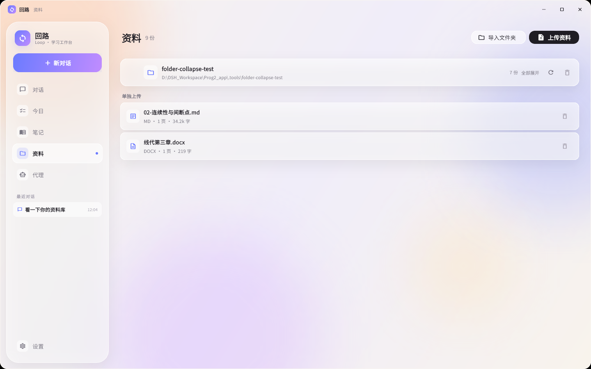
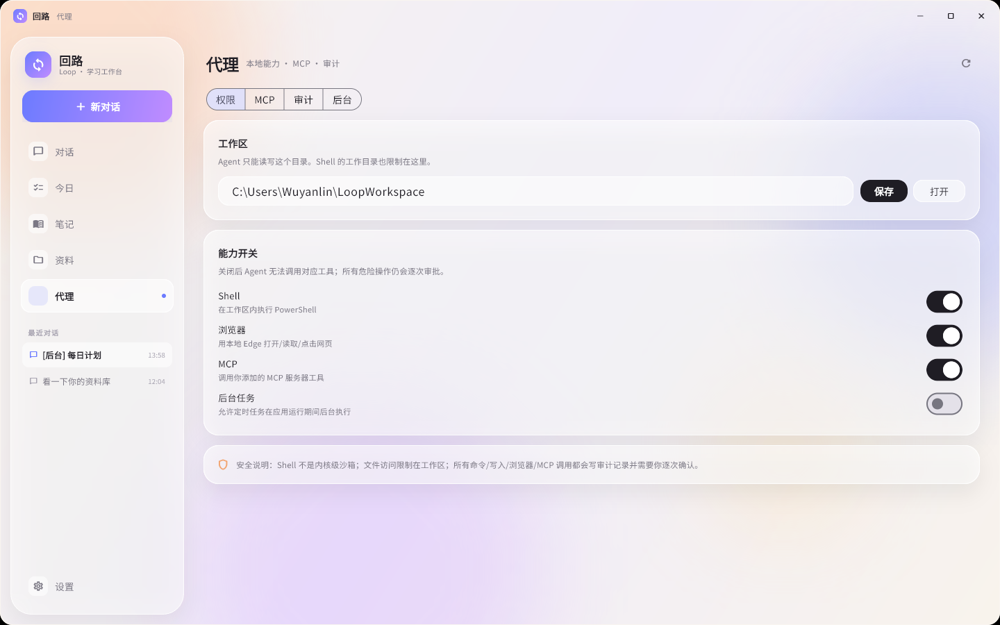
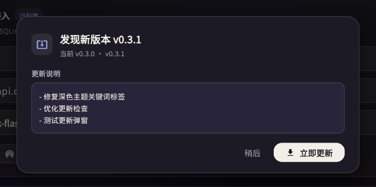
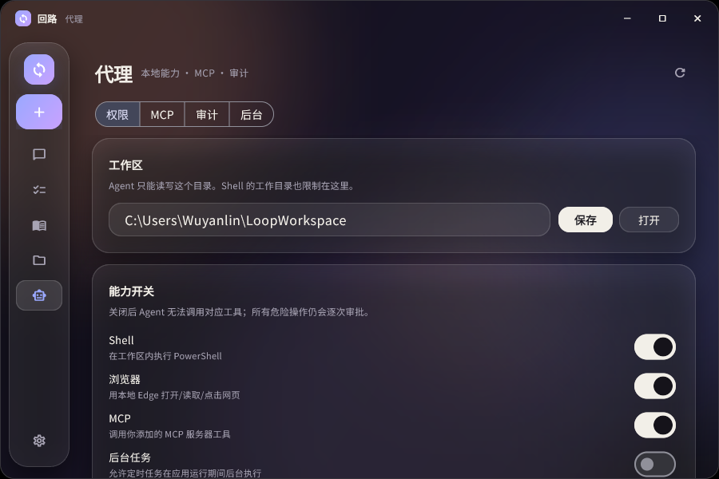

# Loop 回路

Windows 桌面 AI 学习工作台，当前版本 **v0.6.2**。
对话、资料、待办、笔记和 Agent 都在本机运行，数据存在本地 SQLite，模型使用 DeepSeek。

[下载最新版](https://github.com/wyl123ly/Loop/releases/latest)

| 对话 | 资料 |
|---|---|
|  |  |

| Agent | 自动更新 |
|---|---|
|  |  |

| 窄窗口 900×600 | 桌面答疑悬浮窗 |
|---|---|
|  |  |

## 当前版本功能

### 桌面答疑悬浮窗
- 主窗口标题栏新增「浮窗答疑」按钮，一键把同一个 Loop 窗口切成约 **460×600** 的小窗；默认置顶、无原生标题栏、无侧栏，适合边看题边问。
- 浮窗最小 **360×420**，可拖动、可缩放、可取消置顶；浮窗内提供截图、置顶、返回主窗口、关闭四个按钮。
- 切换复用同一 Flutter 进程与同一 `ChatScreen`/会话/附件/SSE：流式回答不会中断，返回主窗口后仍是同一会话和同一段回答。
- 浮窗截图默认隐藏 Loop 后截取**窗口当前所在显示器**（含多显示器/不同 DPI），框选完成自动上传为 `img_` 图片附件，可继续输入问题后发送。
- 全局快捷键 `Alt+Q` 切换浮窗、`Alt+A` 截图；被其他程序占用时自动降级为按钮操作并在 tooltip 提示，不影响使用。
- 亮/暗主题、900×600 主窗口、360×420 浮窗、长回答滚动、Markdown/公式/代码块、审批/停止均保持可用。
- 修复最大化窗口进出浮窗后的“还原位置”丢失、最大化窗口截图恢复、浮窗 360×420 时隐藏页/过渡帧布局溢出等问题。

### 独立回答浮窗与极简形态（v0.6.0）
- 主窗口提交非空问题后，创建**独立第二顶层回答窗**（`desktop_multi_window` + vendored 无激活补丁）；主窗口仍是聊天/SSE/数据库唯一数据源，回答窗只读，通过本地 `WindowMethodChannel` IPC 接收 snapshot/delta/status/resize_ack/theme。
- 回答窗宽度固定为工作区约 **35%**（逻辑 420–900），高度随流式正文自适应：minH **180** / maxH **min(70%, 760)**，到上限内部滚动；80ms 合并节流；自动锚定在输入条上方并与输入条保持 gap，**零遮挡**。
- 回答窗可拖动、收起、关闭、替换；流式/停止/错误/stream off 状态与主窗一致；会话仍留在主窗口。
- **极简形态**：浮窗缩到最小时，或点浮窗「最小化」按钮，变成 **460×52**（逻辑）紧凑条，只保留输入（含发送/停止）、截图、返回三要素，无消息区/无留白；恒置顶、整条可拖动；返回恢复原浮窗，展开/双击恢复。
- 焦点：点击回答窗正文、标题、滚动条、滚轮不会抢主窗前台或输入焦点；真实中文输入可继续提交。主题切换即时同步到已打开/重建的回答窗；125%/150% 跨屏时回答窗尺寸、位置、DPI 正确，用户手动移动后不被主窗移动拉回。
- 已知：第二引擎冷启动使首次出现约 **1.0–1.1s**（已作为 accepted EXCEPTION 记录，期间主窗有“正在思考…”反馈）；双击回答窗标题恢复自动位置的行为已移除（见 release notes）。

### 对话
- 流式输出开关：默认开启逐字显示；关闭后等待完整回复再一次性显示，工具步骤/计划/审批仍实时。设置对下一条消息生效。
- Markdown、KaTeX 数学公式。
- 图片提问；PDF、DOCX、PPTX、TXT、MD 上传解析。
- 聊天内截图：直接截屏，或隐藏 Loop 后截屏；全屏拖拽选框后作为图片附件。
- 图片附件缩略图预览：输入框附件区、发送后的消息里都能看到图片；点击打开大图，支持缩放拖动。
- 多会话历史，左侧「最近对话」切换，上下文相互隔离。
- 回答可一键存笔记 / 加待办。

### 今日
- 待办新增、勾选、删除。
- 逾期标记、今日完成数。

### 笔记
- 笔记列表、Markdown 阅读、复制、删除。
- 对话里的「存笔记」会进入这里。

### 资料
- 单个上传，或直接导入电脑上已有的整个文件夹。
- 支持 PDF、DOCX、PPTX、TXT、MD。
- 文件夹保留原始目录层级，目录可逐层收起/展开。
- 批量导入不限文件数，显示进度，可取消；重复文件可跳过或更新。
- 资料预览、删除；删除整个文件夹会同时清理索引和副本。
- FTS5 中文检索，回答带「资料名 p.页码」。

### Agent
- 计划卡：把任务拆成步骤，实时更新状态。
- 工具：资料检索、待办、笔记、工作区文件读写、Shell、浏览器、MCP。
- 浏览器：本地 Edge 打开/读取/点击/输入/截图。
- MCP：stdio / Streamable HTTP 服务器，工具调用逐次审批。
- 多 Agent：把只读研究、分析、审阅任务委派给子 Agent。
- 所有危险操作在聊天里逐次审批；可随时停止。
- 防卡死：工具调用预算、重复调用跳过、计划自动收尾，写入成功后不再反复确认。
- 代理页：工作区与能力开关、MCP 管理、审计、后台任务。
- 后台任务：按间隔或每天运行，应用/托盘运行期间生效。
- 托盘常驻、关闭到托盘、开机自启。

### 外观与设置
- 暖色背景 + 半透明卡片；无边框窗口、圆角。
- 左侧栏可手动收起为图标列，节省横向空间；状态会记住，窄窗口自动收起。
- 浅色/深色主题；深色下关键词使用淡紫标签。
- 设置：DeepSeek API Key、Base URL、模型切换、连接测试。
- 「对话与模型」：流式输出开关与说明，切换即时保存，重启后保留；对下一条消息生效。
- 自动更新：启动检查 + 设置页手动检查。

### 自动更新
- 从 GitHub Release 读取最新版本和更新说明。
- 下载到 `%LOCALAPPDATA%\Loop\updates`，校验大小与 SHA-256。
- 解压后校验 `version.json` 与 Release 版本一致。
- PowerShell 助手等待旧进程退出，替换程序文件后重启。
- 保留 `data/loop.db`、`data/files` 等用户数据；失败自动回滚。
- 无 GitHub 网络时会提示错误，并保留手动下载入口。

## 下载与运行
- Windows 10/11 x64，解压 `Loop-Desktop-win64.zip` 后双击 `Loop.exe`。
- 数据默认在 `%LOCALAPPDATA%\Loop\data`；可用 `LOOP_DATA_DIR` 指定其他目录。
- 便携版无需安装；更新时程序目录需要可写。
- exe 未代码签名，首次运行可能出现 SmartScreen 提示。

## 版本改动

### v0.6.2 · 2026-10-25
- 修复普通窗口或普通浮窗提问时也触发独立回答浮窗、导致界面卡住的问题。
- 回答浮窗现在严格只在极简形态提交非空文本时创建。
- 退出极简形态（展开回普通浮窗/返回主窗口）时自动关闭回答浮窗，回答内容仍保留在主聊天。
- 新增非极简浮窗不创建回答窗的回归测试。

### v0.6.1 · 2026-10-25
- 修复回答浮窗圆角外露出黑色窗口背景的问题。
- 回答窗使用 Win32 圆角窗口区域，随窗口尺寸/DPI 更新。
- 主窗口、极简条沿用原窗口/DWM 圆角，无本次黑色块问题。

### v0.6.0 · 2026-10-25
- 新增「独立回答浮窗」：仅非空提交后创建第二顶层 Flutter 窗口；主窗唯一数据源，IPC 推送快照/delta/status，回答窗只读。
- 回答窗舒适宽度 35%（420–900 逻辑）、高度自适应、minH180/maxH760、80ms 节流、内部滚动；与输入条零遮挡，可关闭/收起/替换。
- 新增「极简形态」：浮窗缩到最小或点最小化后变为 460×52 三要素紧凑条，置顶可移动，无留白；返回/展开恢复。
- 修复点击回答窗/拖标题/滚动条/滚轮抢主窗焦点；主题切换即时同步；125%/150% 跨屏自动跟随尺寸与 DPI 正确；用户移动回答窗后不被主窗拉回；userMoved 回答窗在 floating/minimal 下重新检查输入条遮挡。
- 保持 v0.5.0 单窗口浮窗、截图、置顶、流式开关、900×600、亮暗主题、最大化恢复与托盘回归。
- 全量 261 条测试通过，analyze 0 issue；真机双屏（125%/150%）与隔离 mock 多窗口闭环验证通过（详见 `docs/release-v0.6.0.md`、`docs/minimal-overlay-test-report.md`）。
- 已知限制：第二引擎首次创建约 1.0–1.1s（accepted EXCEPTION）；真实中文 IME、100% DPI、物理拔显示器、可见任务栏为人工/单测覆盖。

### v0.5.0 · 2026-10-24
- 新增「桌面答疑悬浮窗」：同一进程/同一 Flutter 窗口在普通与浮窗形态间切换，不创建第二引擎。
- 浮窗默认 460×600、最小 360×420，自绘拖动栏，可拖动/缩放/置顶；提供截图、置顶、返回、关闭按钮；无原生标题栏。
- 聊天会话复用同一 `ChatScreen` State、当前 conversation、附件与 SSE：流式中切换形态回答不中断，返回主窗口仍是同一会话。
- 浮窗截图按窗口中心所在显示器工作区捕获，框选后上传为 `img_` 附件；取消/重截/完成均正确恢复原浮窗尺寸、位置与置顶状态。
- 全局快捷键 `Alt+Q` 切换浮窗、`Alt+A` 截图；`RegisterHotKey` 冲突（1409）时降级为按钮可用，不阻塞启动、不反复抢焦点。
- 修复最大化窗口进入浮窗再返回后，Windows「还原」丢失原普通窗口 bounds，以及最大化窗口截图覆盖/恢复不正确的问题。
- 修复浮窗 360×420 时隐藏页与 normal→floating 过渡帧的 RenderFlex/RenderLine 溢出；隐藏页在浮窗形态按 900×600 基准布局，不参与窄宽排版。
- 兼容流式输出 on/off、工具/计划/审批/停止、多模态附件、Markdown/公式/代码块、亮暗主题与 900×600 主窗口。
- 新增浮窗/窗口状态机/显示器几何/截图/布局测试；全量 142 条测试通过，analyze 0 issue；真实双屏（125%/150%）与隔离后端 mock E2E 验证通过（详见 `docs/release-v0.5.0.md` 与 `docs/floating-qa-test-report.md`）。

### v0.4.0 · 2026-10-24
- 新增「流式输出」开关（设置 → 对话与模型），默认开启，保持 v0.3.9 的逐字体验。
- 关闭后后端仍消费模型流（取消、工具调用、协议不变），正文缓冲到整次运行结束前一次性发送；最终正文与落库内容一致。
- 工具步骤、计划、审批、token/完成事件保持实时；多轮工具正文与开启流式时逐字符一致。
- 开关按请求快照生效，只影响下一条消息；状态存 SQLite，老库自动补默认值，重启/升级保留。
- 兼容 Markdown、KaTeX 公式、代码块、图片/截图附件、自定义模式、停止/审批/审计、token/cost 与历史重载。
- 新增流式设置与聊天行为测试 20 条；全量 37 条测试通过；mock LLM 真实端到端验证 24 项通过。

### v0.3.9 · 2026-10-23
- 输入框图片附件改为缩略图预览，点击可查看大图，支持缩放和拖动。
- 发送后的用户消息保留图片附件预览，对话重新加载后仍能显示。
- 消息附件元数据（id、文件名、是否图片）持久化到 SQLite。
- 图片附件服务 `/api/uploads/<id>` 复用现有上传文件，不复制图片。
- 文件附件保留文件名标签；暗色/亮色主题都适配。

### v0.3.8 · 2026-10-23
- 修复截图时窗口没有真正全屏、选框显示异常。
- 修复截图后窗口上方出现 Windows 原生标题栏的问题。
- 截图不再调用 `setFullScreen`，改为保存并恢复窗口 bounds，始终保持 Loop 自绘无边框标题栏。
- 截图全屏实测：逻辑 2048×1152，输出 PNG 2560×1440；取消/完成后恢复原窗口位置和大小。

### v0.3.7 · 2026-10-23
- 聊天输入框新增截图菜单：直接截图 / 隐藏 Loop 后截图。
- 截图后进入全屏选框，拖拽区域、全屏或取消，确认后自动裁切为 PNG。
- 裁切结果直接加入当前消息附件，可继续输入文字后发送。
- 支持 Esc 取消、尺寸提示、选框手柄；保留窗口最大化/还原状态。
- 截图仅支持 Windows 桌面版，截取主屏幕。

### v0.3.6 · 2026-10-23
- 修复加粗文本里的行内公式不渲染、显示成 `$r(A)$` 原文的问题。
- 加粗/斜体/链接改为递归解析内部内容，公式、行内代码、嵌套格式都能正确渲染。
- 兼容模型写出的 `\$...\$` 转义公式。
- 新增 6 个 Markdown 公式回归测试，覆盖加粗内公式、斜体、表格、行内代码、转义写法。

### v0.3.5 · 2026-10-23
- 修复 Agent 写完笔记后反复确认「笔记是否写入」、计划卡在 in_progress 的问题。
- 工具调用预算从 12 次提升到 24 次，最大轮次提升到 20。
- 写操作返回 note_id / committed，成功后自动完成对应计划步骤。
- 相同工具 + 相同参数重复调用直接跳过；连续重复 2 次强制结束并给结论。
- 正常结束或达到上限时自动收尾计划：in_progress → done，pending → skipped。
- 系统提示不再强制写后回读；只有失败或用户要求时才核对。
- 实测 12 步「检索 + 写笔记」可正常完成；连续重复 list_notes 会被跳过。

### v0.3.4 · 2026-10-23
- 修复拖拽缩放窗口时的卡顿。
- 移除了 4 个全屏高斯模糊光斑，改用径向渐变。
- 拖拽期间玻璃面板自动切换为纯色并跳过阴影，松手后恢复玻璃效果。
- 侧栏宽度监听下移，缩放时不再重建整个页面树。

### v0.3.3 · 2026-10-23
- 左侧栏支持手动收起为图标列，节省横向空间。
- 收起状态会保存，重启后恢复；窗口过窄时仍自动收起。
- 展开/收起带过渡动画，图标悬停显示名称。

### v0.3.2 · 2026-10-23
- 修复无边框窗口无法拖拽调整大小的问题。
- 窗口支持四边/四角拖拽缩放，最小 900×600。
- 启动时按屏幕大小自适应并居中，避免窗口超出屏幕。
- 窄窗口下侧栏自动收窄为图标栏，对话、资料、设置、Agent 页面均可正常使用。

### v0.3.1 · 2026-10-23
- 首个公开 GitHub Release。
- 自动更新链路可用：启动检查、设置页检查、下载校验、替换重启、失败回滚。
- 版本号从 0.3.0 提升到 0.3.1；功能与 0.3.0 基线一致。
- 发布附件：`Loop-Desktop-win64.zip`。

### v0.3.0 · 2026-10-23
- 基线版本。
- 后端改为进程内 Dart，无 Python、无 sidecar。
- 对话、资料、今日、笔记、设置。
- 文件夹导入、目录层级、逐层折叠。
- Agent 平台：计划/审批、文件、Shell、浏览器、MCP、多 Agent、审计、后台任务。
- 深色/浅色主题、无边框圆角窗口。
- 自动更新基础实现。

> 本仓库从 v0.3.0 开始记录版本改动。

## 相关文档
- 完整 v0.5.0 说明：[docs/release-v0.5.0.md](docs/release-v0.5.0.md)
- 悬浮窗规格与验收契约：[docs/floating-qa-spec.md](docs/floating-qa-spec.md)
- 悬浮窗端到端验证报告：[docs/floating-qa-test-report.md](docs/floating-qa-test-report.md)
- 完整 v0.4.0 说明：[docs/release-v0.4.0.md](docs/release-v0.4.0.md)
- 完整 v0.3.1 说明：[docs/release-v0.3.1.md](docs/release-v0.3.1.md)
- 自动更新发布规范：[docs/自动更新.md](docs/自动更新.md)
